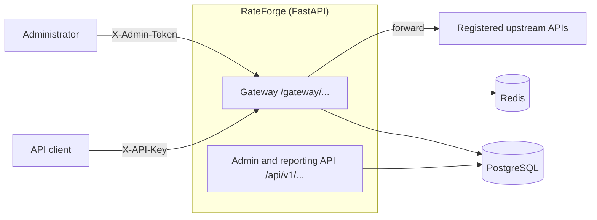

# RateForge

A multi-tenant **API gateway and rate-limiting platform**. Clients call a single entry point with an
API key; RateForge authenticates them, applies their plan's limits, forwards the request to a
registered backend, and records what happened.

Built with **FastAPI, PostgreSQL, Redis and Docker**, as a study in practical backend engineering:
secure key management, distributed rate limiting, safe request proxying, observability, and
honest measurement.

## What it does

- **API keys done properly.** High-entropy keys, shown once, stored only as an HMAC; revocation,
  expiry, and per-tenant isolation.
- **Distributed rate limiting.** A token bucket per tenant plus an optional monthly quota, enforced
  by one atomic Redis Lua script, so any number of gateway instances share one limit.
  *Measured: 200 concurrent requests against a limit of 50 allow exactly 50 (a naive
  read-then-write version let all 200 through).*
- **Safe reverse proxy.** Clients choose a route, never a destination. SSRF-resistant URL handling,
  path-traversal checks, header filtering, streamed bodies, timeouts, no automatic retries.
- **Plans and quotas.** Basic / Pro / Enterprise style plans, with history when a tenant changes plan.
- **Usage analytics.** Per-request records and an analytics API: counts, error rate, p50/p95/p99
  latency, top routes, timeline. No credentials, query strings or bodies are ever stored.
- **Predictable failures.** Upstream, Redis and PostgreSQL failures give clear, retryable errors,
  and each was exercised for real ([failure scenarios](docs/failure-scenarios.md)).
- **Observable.** Structured JSON logs with request IDs, Prometheus metrics, liveness and readiness
  endpoints.

## Architecture



Request lifecycle, data model, caches and scaling notes: [docs/architecture.md](docs/architecture.md).

## Quick start

Requires Docker Desktop.

```bash
cp .env.example .env
docker compose up --build
```

This starts the API (`localhost:8000`), a second API instance (`localhost:8001`, to demonstrate
shared limits), PostgreSQL, Redis, and a small `echo` upstream. Migrations run automatically.
Interactive API docs: <http://localhost:8000/docs>.

```bash
# In a second terminal: create plans, a demo route, and a demo tenant + API key (shown once)
docker compose run --rm api python scripts/seed.py --demo-key

# Call the gateway (on Windows PowerShell, use curl.exe)
curl "http://localhost:8000/gateway/echo/hello?x=1" -H "X-API-Key: <API_KEY>"
```

The echo upstream replies with what it received, so you can see that the path and query arrived,
that your key did **not** get forwarded, and which headers the gateway added. Then:

```bash
curl "http://localhost:8000/api/v1/usage/summary" -H "X-API-Key: <API_KEY>"   # analytics
docker compose run --rm api python scripts/demo_rate_limit.py --key <API_KEY> --requests 80
```

The last command alternates requests between the two gateway instances and shows the total allowed
stays at the plan limit (about 60 for Basic, plus the few tokens refilled while it runs).

## API overview

**Gateway** (tenant API key in `X-API-Key`)

| Path | Purpose |
|---|---|
| `/gateway/{route}/{path}` | Forwarded to the route's registered upstream. Rate-limit headers on every response; `429` + `Retry-After` when over a limit. |

**Admin** (`X-Admin-Token`; keys, usage and analytics are also available to tenants for their own data)

| Method | Path | Purpose |
|---|---|---|
| POST / GET | `/api/v1/tenants` | Create / list tenants |
| POST / GET | `/api/v1/plans` | Create / list plans |
| PUT | `/api/v1/tenants/{id}/plan` | Assign or change a plan |
| POST / GET / DELETE | `/api/v1/keys` | Issue (secret shown once), list metadata, revoke |
| POST / GET / PATCH | `/api/v1/upstreams`, `/api/v1/routes` | Register and enable/disable backends and routes |
| GET | `/api/v1/usage` | Individual requests, filters, keyset pagination |
| GET | `/api/v1/usage/summary` | Aggregates, percentiles, top routes, timeline |

**Operations**: `GET /health/live`, `GET /health/ready`, `GET /metrics` (admin token).

## Configuration

All settings are environment variables (see `.env.example`). The two secrets are required and the
app will not start without them.

| Variable | Default | Meaning |
|---|---|---|
| `API_KEY_HMAC_SECRET` | required | Secret for hashing API keys. Changing it invalidates all keys. |
| `ADMIN_TOKEN` | required | Credential for the admin API. |
| `DATABASE_URL`, `REDIS_URL` | local | Connections |
| `RATE_LIMIT_FAILURE_MODE` | `closed` | `closed`: 503 if Redis is down. `open`: forward without limiting. |
| `POLICY_CACHE_TTL_SECONDS` / `ROUTE_CACHE_TTL_SECONDS` | `30` / `5` | Cache lifetimes (`0` disables the route cache) |
| `GATEWAY_MAX_BODY_BYTES` | 10 MB | Largest accepted request body |
| `ALLOW_PRIVATE_UPSTREAMS` | `true` | Set `false` if every upstream is a public API |
| `DB_POOL_SIZE`, `DB_MAX_OVERFLOW`, `DB_POOL_TIMEOUT_SECONDS`, `DB_CONNECT_TIMEOUT_SECONDS` | 10, 10, 5, 5 | Database pool (per process) |
| `REDIS_TIMEOUT_SECONDS`, `REDIS_MAX_CONNECTIONS` | 0.5, 100 | Redis client |
| `USAGE_RECORDING_ENABLED`, `USAGE_QUEUE_SIZE`, `USAGE_BATCH_SIZE`, `USAGE_FLUSH_INTERVAL_SECONDS` | true, 10000, 100, 1.0 | Usage recording |
| `METRICS_PUBLIC` | `false` | Allow unauthenticated `/metrics` (only if not reachable from outside) |
| `LOG_LEVEL`, `ENVIRONMENT` | `INFO`, `development` | |

## Testing

```bash
docker compose run --rm api pytest                    # 422 tests
docker compose run --rm api ruff check .              # lint
docker compose run --rm api python scripts/smoke_test.py --key <API_KEY>   # live stack check
```

- **422 tests, about 98% line coverage**, against real PostgreSQL and Redis (not mocks of them).
  Integration tests create their own databases and Redis database 15, and skip locally if the
  services are missing (they *fail* in CI so they can never be silently skipped).
- Covers: key handling, authentication, plans, routing and proxying, header and path handling,
  rate limiting (including 200-way concurrency and two-instance sharing), quotas, caching,
  usage recording and analytics maths, metrics, dependency outages, startup/shutdown, and a
  [security suite](docs/security.md) (injection, SSRF, header injection, credential leaks, fuzzing).
- **CI** (`.github/workflows/ci.yml`): lint, migrations from an empty database, migration drift
  check, downgrade/upgrade, tests with a 90% coverage gate, then a container smoke test.

## Security

Threat model, controls, and the test that proves each one: [docs/security.md](docs/security.md).
Highlights: HMAC-hashed keys, constant-time checks, one generic 401, admin-registered destinations
only, SSRF-aware URL validation, path normalisation, credentials never forwarded or logged.

## Reliability

Behaviour under failure, observed by actually breaking each dependency:
[docs/failure-scenarios.md](docs/failure-scenarios.md). In short: slow upstream is a 504 after its
timeout, dead upstream a 502, Redis or PostgreSQL down a 503 with `Retry-After`, and everything
recovers on its own when the dependency returns.

## Performance

How it is measured, how to reproduce it, and recorded results: [docs/load-testing.md](docs/load-testing.md)
and [docs/performance.md](docs/performance.md). Profiling the gateway under load showed about half its
CPU going to database reads, which led to a route cache; an A/B measurement showed about 13% more
throughput with it on (small sample on a 1-CPU machine, so a direction, not a benchmark).

No throughput or latency targets are claimed here: figures in this repository are measurements,
always recorded with the machine and settings they came from.

## Project layout

```
app/        gateway, admin API, services, repositories, models, metrics
tests/      unit, integration, security, load
scripts/    seed, demo, load-test runner, smoke test, echo upstream
docs/       architecture, security, failure scenarios, load testing, performance, decisions/
```

Design decisions with their reasoning: [docs/decisions/](docs/decisions/).

## Limitations

Stated plainly, because knowing them is part of the design:

- **One shared admin token**, not admin accounts and roles.
- **Usage analytics are best-effort**: events are queued in memory, so a crash can lose the latest
  few seconds, and a failed database write drops its batch (counted, not retried).
- **Monthly quotas live in Redis**: accurate under concurrency, but not billing-grade if Redis loses data.
- **Every request needs PostgreSQL** (keys are deliberately not cached so revocation is immediate),
  so a database outage is a gateway outage, though a clean 503.
- **Cache delay across instances**: a plan change can take up to 30 s and a route change up to 5 s to
  be seen by *other* instances.
- **Limits are per tenant**, not per key or per route.
- **SSRF**: URLs are validated as written; DNS rebinding is not fully closed without network egress rules.
- No TLS termination, WebSocket proxying, circuit breaker, usage-data retention job, or tracing.

## Where this could go next

Per-key and per-route limits; a short-lived key cache (a deliberate revocation-delay trade-off);
Redis Streams or a message queue for usage events; hourly rollups and partitioning for analytics;
a circuit breaker for failing upstreams; admin accounts and audit logs; deployment on AWS
(ECS Fargate, RDS, ElastiCache) with HTTPS and secrets management.
