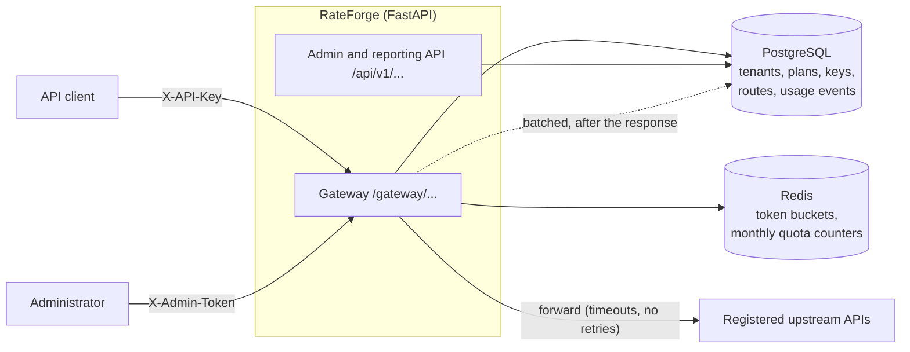
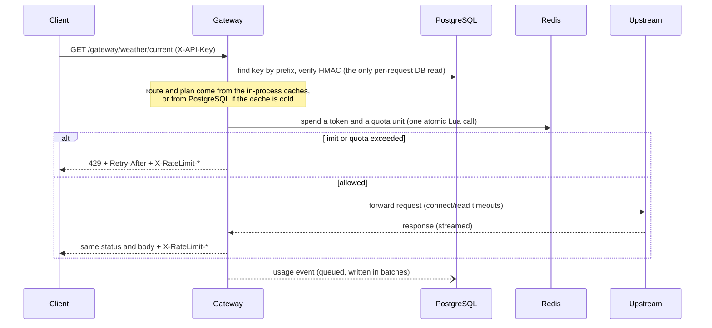
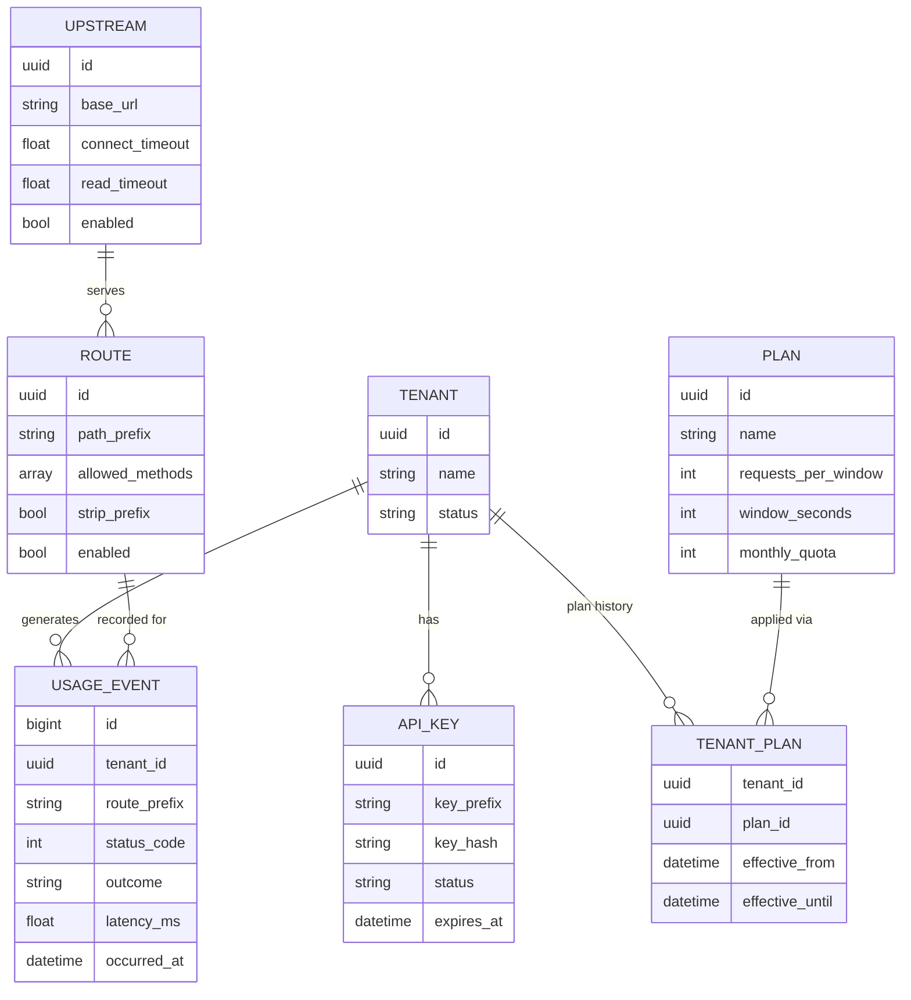

# Architecture

RateForge is one FastAPI application backed by PostgreSQL (durable data) and Redis (shared,
short-lived rate-limit state). It has two logical halves, deployed together:

- **Data plane**: the `/gateway/...` path. Authenticates the caller, applies the tenant's plan,
  forwards the request, records what happened. Kept as short as possible.
- **Control plane**: the `/api/v1/...` admin and reporting API. Creates tenants, plans, keys,
  upstreams and routes, and answers usage questions. Its changes decide how the data plane behaves.

They are separate routers and service modules in one process. That keeps the project simple to run
while leaving a clear line along which they could be split into separate deployments later.



## What happens to a request



In words:

1. **Receive.** Middleware assigns a request ID (or accepts a safe inbound one) and starts timing.
2. **Authenticate.** The key `rf_<prefix>_<secret>` is split; the row is found by prefix and the
   whole key is verified against a stored HMAC-SHA256 with a constant-time comparison. Unknown,
   malformed, wrong, revoked and expired keys all produce the same 401.
3. **Resolve the route.** `/gateway/<prefix>/...` must match a registered, enabled route whose
   upstream is also enabled; the HTTP method must be allowed; the path must be free of traversal
   tricks. The destination is **always** the admin-registered upstream. A client cannot supply one.
4. **Resolve the plan and rate limit.** The tenant's plan sets a token bucket and optional monthly
   quota. One Lua script in Redis checks and updates both atomically, so any number of gateway
   instances enforce one shared limit.
5. **Forward.** The request goes to the upstream with hop-by-hop headers removed, the client's
   credentials stripped, and gateway headers added. Bodies stream in both directions. There are no
   automatic retries.
6. **Respond.** The upstream's status, headers and body are streamed back with rate-limit headers.
7. **Record.** After the last byte, the middleware logs one structured line, updates metrics, and
   queues a usage event.

## Data model



Plan changes close the current `tenant_plans` row and open a new one, so history is kept.

## Where each piece of state lives

| State | Where | Why |
|---|---|---|
| Tenants, plans, keys (as hashes), routes, upstreams | PostgreSQL | Durable business data |
| Usage events | PostgreSQL (written in batches) | Queryable history; best-effort, see below |
| Token buckets, monthly quota counters | Redis | Updated on every request; must be shared by all instances; fine to lose |
| Resolved plan per tenant (30 s), route snapshot (5 s) | In-process cache | Avoids a database read per request |
| Usage events not yet written | In-process queue | Keeps recording off the request path |
| Metrics | In-process (or per-worker files) | Scraped by Prometheus |

## Caches and how stale they can be

Speed comes from caching things that rarely change. The price is a delay before changes made
*somewhere else* are noticed. Changes made through the same process take effect immediately.

| Cache | Default | After a change made on another instance | Setting |
|---|---|---|---|
| Tenant plan | 30 s | Up to 30 s | `POLICY_CACHE_TTL_SECONDS` |
| Route and upstream settings | 5 s | Up to 5 s (a disabled route can keep serving this long) | `ROUTE_CACHE_TTL_SECONDS` (0 turns it off) |
| API key lookup | none | Revocation is immediate | n/a |

API keys are deliberately **not** cached, so revoking a key stops it at once. The cost is that the
gateway needs PostgreSQL for every request, so a database outage is a gateway outage (a clean 503;
see [failure scenarios](failure-scenarios.md)).

## Code layout

```
app/
  main.py               application, startup and shutdown
  core/                 configuration, security primitives, logging, middleware,
                        error handling, URL (SSRF) validation, usage context
  api/                  gateway, health, metrics, and v1/ admin and reporting routers
  services/             business rules: authentication, policy, routing, proxy,
                        rate limiter, usage recorder
  repositories/         database queries
  models/ schemas/      database tables and request/response shapes
  observability/        Prometheus metrics
  db/                   session and Alembic migrations
tests/                  unit, integration, security, load
scripts/                seed, demo, load-test runner, smoke test, echo upstream
docs/                   this documentation and design decisions
```

Routers handle HTTP, services hold rules, repositories hold queries. A router that contains a
query, or a service that knows about HTTP, is a bug.

## Scaling notes

- **More instances** behind a load balancer work as they are: limits are shared through Redis,
  data through PostgreSQL. Cache staleness grows only by the TTLs above.
- **More workers per instance** work too, but each worker has its own caches and usage queue, and
  metrics need `PROMETHEUS_MULTIPROC_DIR` set to be combined.
- **Connection budget**: PostgreSQL connections = pool size + overflow, times workers, times
  instances. Keep that below PostgreSQL's `max_connections`.
- **Bottlenecks to expect first**: the per-request key lookup in PostgreSQL, then Redis round
  trips. See [performance](performance.md) and [load testing](load-testing.md) for measurements.
